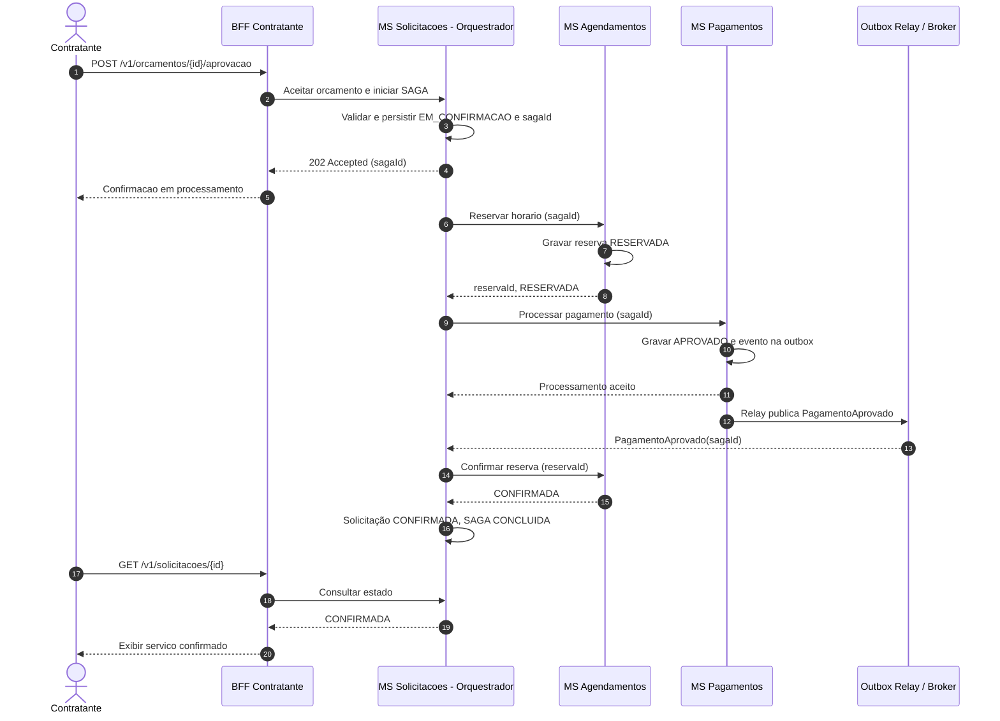

# 3. SAGA Orquestrada — Aceite de Orçamento

## 3.1 Objetivo e contexto

Na **ResolveLar**, o aceite de um orçamento não é uma única operação de banco de dados. Para confirmar um serviço de manutenção residencial, a plataforma precisa **registrar a decisão do contratante**, **reservar um horário do prestador** e **processar o pagamento**. Essas operações pertencem a microsserviços com bancos PostgreSQL independentes, conforme definido em [`01-decomposicao-e-dados.md`](01-decomposicao-e-dados.md).

A transação de negócio atravessa três serviços de domínio:

| Microsserviço | Responsabilidade na SAGA | Estado/resultado local |
|---|---|---|
| **MS Solicitações (e Orçamentos)** | **Orquestrador**: valida o orçamento, registra o identificador da SAGA, comanda as etapas e consolida o resultado. | Solicitação `EM_CONFIRMACAO`, depois `CONFIRMADA` ou `AGUARDANDO_ACEITE`; SAGA `EM_ANDAMENTO`, `CONCLUIDA` ou `COMPENSADA`. |
| **MS Agendamentos** | Impede conflitos de agenda; cria uma reserva temporária, confirma ou libera a vaga. | Reserva `RESERVADA`, `CONFIRMADA` ou `LIBERADA`. |
| **MS Pagamentos** | Realiza o processamento financeiro, registra seu resultado e publica eventos confiáveis. | Pagamento `APROVADO`, `RECUSADO` ou, se necessário, `CANCELADO`/`ESTORNADO`. |

**Regra de negócio:** o serviço só é considerado **confirmado** quando a reserva estiver confirmada e o pagamento estiver aprovado. Enquanto isso, o aplicativo deve apresentar um status de processamento, sem informar incorretamente que o atendimento já está garantido.

## 3.2 Por que SAGA orquestrada (e não coreografada)?

A opção adotada é **somente a SAGA orquestrada**. O **MS Solicitações** conhece a ordem das etapas, acompanha os resultados e decide quando executar compensações. Assim, a regra de negócio do aceite fica centralizada no serviço que já gerencia solicitações e orçamentos.

Na alternativa **coreografada**, cada serviço reagiria autonomamente a eventos para iniciar a próxima etapa. Embora isso reduza a dependência de um coordenador, pode espalhar a lógica de compensação por vários serviços e dificultar a identificação do estado final da operação. Para um fluxo curto e crítico, envolvendo agenda e dinheiro, a orquestração oferece **maior rastreabilidade e clareza na recuperação de falhas**.

**Trade-off:** o orquestrador passa a ser um componente importante para o fluxo. Por isso, seu estado deve ser persistido no banco do MS Solicitações, permitindo continuar uma SAGA interrompida após reinício, e todos os comandos devem ser idempotentes.

## 3.3 Contrato de entrada e estados

O contratante inicia a confirmação pelo app web, passando pelo **Kong API Gateway** e pelo **BFF do Contratante** até o MS Solicitações. A rota pública segue a proposta REST do grupo:

```http
POST /v1/orcamentos/orc_42/aprovacao
Authorization: Bearer <JWT>
Content-Type: application/json
Idempotency-Key: aceite-orc_42-contratante_15
```

```json
{
  "horarioEscolhido": "2026-10-28T14:00:00Z",
  "meioPagamentoId": "pm_tok_123"
}
```

O MS Solicitações valida se o orçamento está pendente e dentro da validade, se pertence ao contratante autenticado e se o horário solicitado é compatível com a proposta. O identificador do meio de pagamento representa um **token**, nunca dados brutos de cartão.

Como a confirmação envolve operações distribuídas e eventos, a resposta inicial recomendada é **`202 Accepted`**, e não a indicação prematura de sucesso completo:

```json
{
  "sagaId": "saga_52",
  "solicitacaoId": "sol_8f21",
  "orcamentoId": "orc_42",
  "status": "EM_CONFIRMACAO",
  "_links": {
    "acompanhar": {
      "href": "/v1/solicitacoes/sol_8f21",
      "method": "GET"
    }
  }
}
```

Se o orçamento estiver vencido, recusado ou já consumido por outra aprovação, o MS Solicitações retorna **`409 Conflict`**. A API de consulta de solicitações informa o resultado final ao BFF: `CONFIRMADA` ou `AGUARDANDO_ACEITE` acompanhado do motivo da falha.

## 3.4 Caminho feliz — confirmação bem-sucedida

1. O **contratante aceita um orçamento**, informando o horário e um meio de pagamento tokenizado. O BFF encaminha o comando ao MS Solicitações.
2. O **MS Solicitações** valida os dados e registra, no próprio banco, a SAGA `EM_ANDAMENTO` e a solicitação `EM_CONFIRMACAO`, com `sagaId` único; então retorna `202 Accepted`.
3. O orquestrador envia ao **MS Agendamentos** o comando para reservar o horário. O serviço verifica conflitos e registra a vaga como `RESERVADA`, devolvendo `reservaId`.
4. O orquestrador envia ao **MS Pagamentos** a solicitação de pagamento. Ao aprovar a operação, o serviço grava o pagamento `APROVADO` e o evento `PagamentoAprovado` na tabela **outbox**, na **mesma transação local ACID**.
5. Um **Outbox Relay** publica `PagamentoAprovado` no **message broker**. O MS Solicitações consome o evento (correlacionado pelo `sagaId`) e registra a confirmação do pagamento.
6. O **MS Solicitações** solicita ao **MS Agendamentos** que confirme a reserva. A reserva passa a `CONFIRMADA`.
7. O orquestrador registra a solicitação como `CONFIRMADA` e a SAGA como `CONCLUIDA`. Na próxima consulta, o contratante visualiza o serviço confirmado.

### Diagrama de sequência — sucesso



> O relay é representado junto do broker apenas para simplificar a leitura do diagrama. A gravação da **outbox ocorre dentro do banco do MS Pagamentos**, enquanto o relay realiza a publicação posteriormente.

## 3.5 Cenário de falha — pagamento recusado

Suponha que o MS Agendamentos **já reservou a vaga**, mas a operadora recuse o pagamento. Manter o horário bloqueado impediria outro contratante de utilizá-lo, mesmo sem contratação válida. O orquestrador precisa, portanto, executar uma **transação compensatória**.

1. O MS Pagamentos registra o resultado `RECUSADO` e publica, via outbox/broker, o evento `PagamentoRecusado` (mesmo mecanismo do evento de sucesso).
2. O MS Solicitações recebe `PagamentoRecusado` e identifica qual reserva deve ser desfeita pelo `sagaId`.
3. O orquestrador envia ao MS Agendamentos **`LiberarReserva(reservaId)`**, que marca a reserva `LIBERADA` e devolve a disponibilidade do horário.
4. Após a confirmação da liberação, o MS Solicitações reverte `EM_CONFIRMACAO` para `AGUARDANDO_ACEITE` e marca a SAGA `COMPENSADA`. O orçamento poderá ser tentado novamente, se ainda estiver válido, conforme as regras do negócio.
5. O BFF informa ao cliente que a confirmação **não foi concluída** porque o pagamento não foi autorizado.

### Diagrama de sequência — falha com compensação

```mermaid
sequenceDiagram
    autonumber
    actor Cliente as Contratante
    participant BFF as BFF Contratante
    participant SOL as MS Solicitacoes - Orquestrador
    participant AGEN as MS Agendamentos
    participant PAG as MS Pagamentos
    participant BUS as Outbox Relay / Broker

    Cliente->>BFF: POST /v1/orcamentos/{id}/aprovacao
    BFF->>SOL: Aceitar orcamento e iniciar SAGA
    SOL->>SOL: Persistir EM_CONFIRMACAO e sagaId
    SOL-->>BFF: 202 Accepted
    BFF-->>Cliente: Confirmacao em processamento

    SOL->>AGEN: Reservar horario (sagaId)
    AGEN-->>SOL: reservaId, RESERVADA
    SOL->>PAG: Processar pagamento (sagaId)
    PAG->>PAG: Gravar RECUSADO e evento na outbox
    PAG->>BUS: Relay publica PagamentoRecusado
    BUS-->>SOL: PagamentoRecusado(sagaId)

    Note over SOL,AGEN: COMPENSACAO: desfazer a reserva
    SOL->>AGEN: LiberarReserva(reservaId)
    AGEN->>AGEN: Marcar LIBERADA e devolver a vaga
    AGEN-->>SOL: Reserva liberada
    SOL->>SOL: Voltar a AGUARDANDO_ACEITE e marcar COMPENSADA

    Cliente->>BFF: GET /v1/solicitacoes/{id}
    BFF->>SOL: Consultar estado
    SOL-->>BFF: Falha no pagamento; SAGA COMPENSADA
    BFF-->>Cliente: Informar falha e permitir nova tentativa
```

## 3.6 Transações compensatórias e outras falhas

A SAGA não realiza um `ROLLBACK` global entre os bancos: cada serviço confirma sua própria transação e, quando necessário, executa **novas operações de negócio que desfazem os efeitos anteriores**.

| Ponto de falha | Efeitos já realizados | Ação do MS Solicitações / compensação |
|---|---|---|
| **Horário indisponível** | Solicitação marcada `EM_CONFIRMACAO`; nenhum pagamento foi iniciado. | Encerrar a tentativa e voltar para `AGUARDANDO_ACEITE`; não há reserva para liberar. |
| **Pagamento recusado** | Reserva `RESERVADA`; não houve cobrança aprovada. | **Liberar a reserva** no MS Agendamentos e reverter o estado da solicitação. |
| **Pagamento aprovado, mas confirmação definitiva da reserva falha** | Reserva provisória + pagamento aprovado. | **Cancelar a autorização ou solicitar estorno**, conforme a etapa financeira; depois **liberar a reserva** e reverter a solicitação. |
| **Falha transitória ao persistir a confirmação final da solicitação** | Pagamento aprovado e reserva confirmada. | **Repetir a persistência de forma idempotente** até concluir; se a operação não puder ser recuperada, iniciar compensação financeira e liberação da vaga, com conciliação. |
| **Falha na própria compensação** | Alguma etapa permanece pendente de reversão. | Marcar SAGA `COMPENSACAO_PENDENTE`, executar tentativas com *backoff* e alertar para conciliação; nunca anunciar a compensação como concluída antes da confirmação. |

Em particular, **estornar um pagamento não é o mesmo que desfazer uma linha de banco**: pode depender do provedor externo e levar algum tempo. O sistema deve acompanhar essa operação até sua conclusão.

## 3.7 Confiabilidade, consistência e rastreabilidade

- **Idempotência:** todas as operações usam `sagaId` (e, na entrada pública, `Idempotency-Key`). Repetir uma requisição ou consumir um evento duplicado não pode reservar duas vagas nem realizar duas cobranças.
- **Correlação e persistência:** o MS Solicitações guarda o `sagaId`, o estágio atual, `reservaId`, `pagamentoId`, resultados e tentativas. Após reiniciar, o orquestrador retoma processos incompletos sem repetir efeitos indevidos.
- **Outbox e entrega pelo menos uma vez:** o MS Pagamentos escreve seu estado e o evento correspondente numa transação local; o relay publica no broker. Como mensagens podem chegar duplicadas, o consumidor controla os eventos processados por `eventId`/`sagaId`.
- **Timeout não significa pagamento recusado:** diante de resposta desconhecida do MS Pagamentos, o orquestrador consulta/concilia o estado usando a chave idempotente **antes de liberar a reserva**. Isso evita liberar um horário quando o pagamento pode ter sido efetivado.
- **Reserva temporária:** a vaga pode ter prazo de expiração para evitar bloqueios órfãos, mas a liberação explícita pela compensação continua obrigatória. Uma expiração não pode conflitar com uma confirmação legítima em andamento.
- **Consistência eventual:** durante a SAGA, os bancos podem mostrar estados intermediários diferentes. O app utiliza o status consolidado pelo MS Solicitações e não considera o serviço confirmado antes da conclusão.
- **Observabilidade:** registrar logs e métricas por `sagaId`, incluindo duração, falhas, compensações e operações financeiras pendentes.

## 3.8 Alinhamento com os demais documentos

A arquitetura acima preserva os microsserviços, o PostgreSQL por serviço e o evento **`PagamentoAprovado` via outbox** já definidos no documento `01-decomposicao-e-dados.md`. O evento **`PagamentoRecusado`** e o contrato de compensação **`LiberarReserva`** são extensões propostas para cobrir o cenário de falha exigido na Parte 2.

**Decisão de integração a validar com o grupo:** como o aceite já inicia a reserva e o pagamento, a rota pública `POST /v1/orcamentos/{id}/aprovacao` deve responder inicialmente `202 Accepted`, e os contratos REST/HATEOAS devem refletir o estado `EM_CONFIRMACAO` antes de oferecer qualquer ação posterior de agendamento. Isso evita que a documentação de REST apresente um segundo agendamento independente para a mesma contratação.
