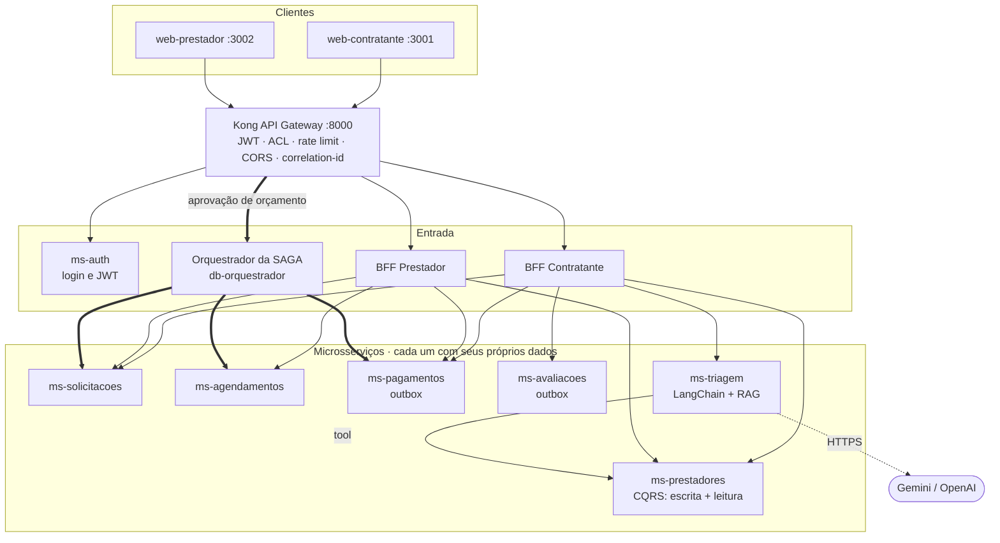

<p align="center">
  
</p>

<p align="center">
  🎬 <a href="https://drive.google.com/file/d/1SnIOJtxUfM0VqZtyuaxNdM6dCesn9Z0n/view?usp=sharing"><strong>Assista ao vídeo de apresentação — ResolveLar Parte 4</strong></a>
</p>

## Equipe

* Marcus Vinícius Alves Silva
* Maria Clara Miguel Silva
* João Paulo Souza Selvati
* Luiza Oliveira de Souza Garcia

**Sumário:** [Problema](#1-problema-e-impacto) · [Arquitetura](#2-arquitetura) · [Fluxos](#3-fluxos-principais) · [Como rodar](#4-como-rodar) · [Documentação](#5-documentação) · [Repositório](#6-estrutura-do-repositório) · [Contribuir](#7-como-contribuir) · [Referências](#referências)

## 1. Problema e impacto

<p>
  

  Encontrar um profissional para um problema em casa (chuveiro queimado, vazamento, fechadura quebrada) ainda depende de indicações informais e buscas dispersas. O contratante não sabe quem atende a região, quanto custa nem se o profissional é confiável; o prestador autônomo tem dificuldade de achar clientes e construir reputação.
</p>

<p>
  O mercado é grande e está em plena transformação: cerca de 1,7 milhão de pessoas trabalhavam por plataformas digitais de serviços em 2024, e o segmento de serviços gerais foi o que mais cresceu (+52,1%) [1]. A manutenção residencial é um mercado expressivo e fragmentado [2], e a plataformização sem estrutura tende a precarizar o trabalho [3][4].
</p>

<br clear="left">

**A ResolveLar** centraliza o ciclo inteiro da contratação: o cliente descreve o problema (com triagem por IA), recebe orçamentos de profissionais compatíveis, aprova com pagamento e agendamento confirmados juntos, e avalia o serviço.

| Quem se beneficia | Como |
|---|---|
| **Contratantes** | Encontram profissionais da região com avaliações, orçamentos comparáveis e orientações de segurança imediatas |
| **Prestadores** | Recebem demandas da sua área, montam reputação digital e organizam agenda e ganhos |

**Indicadores de impacto:** profissionais ativos, serviços concluídos, solicitações atendidas, tempo médio entre pedido e contratação, e nota média.

> O texto completo da Parte 1 (pitch, problema, impacto e jornada de uso) está em [`docs/00-readme-anterior.md`](docs/00-readme-anterior.md).

## 2. Arquitetura

Microsserviços com API Gateway, um BFF por tipo de cliente, um orquestrador de SAGA fora dos serviços de domínio e um banco por serviço. Tudo sobe com um único `docker compose up`.



As setas são chamadas HTTP (timeout curto, `X-Correlation-Id` em todas). Além delas, os serviços trocam **eventos pelo RabbitMQ**: `PagamentoAprovado`/`PagamentoRecusado` (do `ms-pagamentos` para o orquestrador) e `AvaliacaoRegistrada` e eventos do prestador (para o banco de leitura do `ms-prestadores`). O Redis guarda o rate limit do Kong e o cache de buscas e triagens. Só o Kong e os dois apps têm porta no computador; o resto fica em rede interna.

As setas são chamadas HTTP (timeout curto, `X-Correlation-Id` em todas). Além delas, os serviços trocam **eventos pelo RabbitMQ**: `PagamentoAprovado`/`PagamentoRecusado` (do `ms-pagamentos` para o orquestrador) e `AvaliacaoRegistrada` e eventos do prestador (para o banco de leitura do `ms-prestadores`). O Redis guarda o rate limit do Kong e o cache de buscas e triagens. Só o Kong e os dois apps têm porta no computador; o resto fica em rede interna.

### Componentes

| Componente | Papel | Banco (PostgreSQL) |
|---|---|---|
| `kong` | Única porta de entrada: valida JWT e perfil, limita taxa por usuário, encaminha às rotas | — (DB-less, `gateway/kong.tpl.yml`) |
| `bff-contratante`, `bff-prestador` | Montam a resposta de cada tela (dados diferentes para cada perfil) | — |
| `orquestrador-saga` | Coordena a contratação entre solicitações, agenda e pagamento; **sem dados de domínio** | `db-orquestrador` (só o andamento das SAGAs) |
| `ms-solicitacoes` | Pedidos e orçamentos (HATEOAS) | `db-solicitacoes` |
| `ms-agendamentos` | Reservas de horário sem sobreposição | `db-agendamentos` |
| `ms-pagamentos` | Cobrança simulada, estorno e repasse; Transactional Outbox | `db-pagamentos` |
| `ms-prestadores` | Perfis e busca de profissionais com **CQRS** | `db-prestadores-write` + `db-prestadores-read` |
| `ms-avaliacoes` | Notas dos serviços; publica a nova média por outbox | `db-avaliacoes` |
| `ms-triagem` | Assistente de triagem com LLM, RAG (ChromaDB) e tool | — (índice vetorial em volume) |
| `ms-auth` | Login dos usuários de demonstração e emissão do JWT | — |
| `rabbitmq`, `redis` | Eventos entre serviços; cache e contadores de rate limit | — |
| `web-contratante`, `web-prestador` | Apps React servidos por Nginx | — |

**Redes:** `edge_net` (apps e Kong), `internal_net` (todo o resto, sem saída para a internet) e `egress_net` (só o `ms-triagem`, para chamar o LLM).

### Onde está cada requisito do trabalho

| Requisito | Onde |
|---|---|
| Microsserviços com banco próprio | 5 de domínio + triagem, 6 bancos de domínio separados ([docs/01](docs/01-decomposicao-e-dados.md)) |
| REST, versionamento `/v1`, HATEOAS, RFC 7807 | Orçamentos e solicitações com `_links` ([docs/04](docs/04-rest-e-cqrs.md)) |
| API Gateway e 2 BFFs | Kong + `bff-contratante` / `bff-prestador` ([docs/02](docs/02-gateway-e-bff.md)) |
| Outbox e consistência eventual | `ms-pagamentos`, `ms-avaliacoes`, `ms-prestadores` |
| SAGA orquestrada com compensação | `orquestrador-saga` ([docs/03](docs/03-saga-orquestrada.md)) |
| CQRS | `ms-prestadores`: banco de escrita + banco de leitura atualizado por eventos |
| Docker: Dockerfiles multi-stage, volumes, redes | `services/*/Dockerfile`, `clients/*/Dockerfile`, `docker-compose.yml` |
| LLM: RAG, LangChain (chain + tool), resiliência, latência e custo | `ms-triagem` ([docs/05-avaliacao-triagem](docs/05-avaliacao-triagem.md)) |

## 3. Fluxos principais

**Contratação (SAGA).** O cliente aprova um orçamento → o Kong manda direto ao **orquestrador**, que responde `202` e coordena: trava o pedido no `ms-solicitacoes` → reserva o horário no `ms-agendamentos` → cobra no `ms-pagamentos`. O resultado do pagamento volta por evento. **Aprovado:** confirma reserva e pedido. **Recusado:** libera a reserva e destrava o pedido (compensação). Para provocar a falha na demonstração, use o cartão de teste recusado (`pm_tok_recusado`).

**Busca de profissionais (CQRS).** Cadastros e avaliações gravam no banco de escrita e publicam eventos; um projetor atualiza o banco de leitura desnormalizado, que responde às buscas (com cache Redis).

**Triagem por IA.** O cliente descreve o problema → o `ms-triagem` busca trechos da base de conhecimento (RAG) → o LLM classifica categoria e urgência e gera orientações de segurança → a tool consulta profissionais reais. Se o LLM falhar ou demorar, timeout, retry, circuit breaker e um fallback por regras garantem a resposta em até ~7 s; respostas repetidas vêm do cache.

## 4. Como rodar

**Pré-requisito:** Docker com Compose v2 (`docker compose version`).

```bash
git clone <url-do-repositorio> ResolveLar
cd ResolveLar
cp .env.example .env
docker compose up -d --build
docker compose ps          # espere todos ficarem "healthy" (1 a 2 min na primeira vez)
```

| App | Endereço | Exemplo de usuário |
|---|---|---|
| Contratante | <http://localhost:3001> | `rafael`, `mariana`, `juliana` |
| Profissional | <http://localhost:3002> | `joao` (encanador), `carlos` (eletricista) |

**Senha de todos:** a `DEMO_PASSWORD` do `.env` (no `.env.example`, `resolvelar123`). O roteiro completo de teste, com todos os usuários, está em [`docs/07-passo-a-passo-testes.md`](docs/07-passo-a-passo-testes.md).

**IA (opcional):** preencha `GEMINI_API_KEY` (ou `OPENAI_API_KEY`) no `.env` e rode `docker compose up -d ms-triagem`. Sem chave, a triagem funciona pelo fallback de regras. Avaliação do RAG: `docker compose exec ms-triagem python -m app.avaliacao`.

> O `.env` guarda as senhas locais e **não vai para o Git**. Os valores do `.env.example` são só para teste.

### Teste rápido pela API

```bash
TOKEN=$(curl -s -X POST http://localhost:8000/v1/auth/login -H 'Content-Type: application/json' \
  -d '{"usuario":"mariana","senha":"resolvelar123"}' | python3 -c "import sys,json;print(json.load(sys.stdin)['access_token'])")
curl -s -H "Authorization: Bearer $TOKEN" http://localhost:8000/v1/contratante/solicitacoes   # 200
curl -i http://localhost:8000/v1/contratante/prestadores                                    # 401, sem token
curl -si -H "Authorization: Bearer $TOKEN" http://localhost:8000/v1/prestador/agenda | head -1  # 403, perfil errado
```

Demonstração da SAGA sem a interface (cartão recusado e depois aprovado):

```bash
docker compose exec -T orquestrador-saga python - < scripts/demo-frente2.py
```

### Parar

```bash
docker compose down       # para e mantém os dados
docker compose down -v    # para e APAGA os dados
```

### Problemas comuns

| Sintoma | O que fazer |
|---|---|
| `defina ... no .env` ao subir | Faltam variáveis novas no seu `.env`: copie as linhas que faltam do `.env.example` |
| Contêiner `unhealthy` | Aguarde 30 s; se continuar, `docker compose logs <serviço>` |
| `port is already allocated` (8000, 3001 ou 3002) | Outro programa usa a porta: feche-o ou mude a porta no `docker-compose.yml` |
| `localhost:8000` não responde, mas o Kong está `healthy` (Windows) | `docker compose up -d --force-recreate kong` |
| "Muitas tentativas" no login | Limite de 5 por minuto por IP: espere um minuto |
| `401` com token | Token expirado (12 h): entre de novo |
| `429` | Rate limit; zere os contadores com `docker compose exec redis redis-cli FLUSHALL` |
| Mudou a senha de um banco no `.env` e ele não aceita | O volume foi criado com a senha antiga: `docker compose down -v` e suba de novo |

## 5. Documentação

| Documento | Conteúdo |
|---|---|
| [01 — Decomposição e dados](docs/01-decomposicao-e-dados.md) | Serviços, fronteiras, banco por serviço, dual write e outbox |
| [02 — Gateway e BFF](docs/02-gateway-e-bff.md) | Kong, rotas, autenticação e diferença entre os BFFs |
| [03 — SAGA orquestrada](docs/03-saga-orquestrada.md) | Orquestrador, caminho feliz, falha com compensação, diagramas de sequência |
| [04 — REST e CQRS](docs/04-rest-e-cqrs.md) | Contratos, HATEOAS, modelo de leitura e defasagem aceitável |
| [05 — Avaliação da triagem](docs/05-avaliacao-triagem.md) | RAG com e sem recuperação, latência e custo em escala |
| [05 — Execução da Frente 2](docs/05-frente2-execucao.md) | Contratos internos da SAGA, mensageria e demonstração |
| [06 — Plano de usabilidade](docs/06-plano-usabilidade.md) | Login, listagens e fluxos completos |
| [07 — Passo a passo de testes](docs/07-passo-a-passo-testes.md) | Roteiro para testar tudo pelo navegador |
| [`.ai-memory/`](.ai-memory/) | Arquitetura detalhada, estado do projeto e registro de decisões |

## 6. Estrutura do repositório

| Caminho | Conteúdo |
|---|---|
| `docker-compose.yml`, `.env.example` | Sistema completo e variáveis (copiar para `.env`) |
| `gateway/kong.tpl.yml` | Configuração do Kong (o `kong.yml` é gerado na subida com o `JWT_SECRET`) |
| `clients/web-contratante`, `clients/web-prestador` | Apps React (Vite) servidos por Nginx |
| `services/bff-*` | BFFs |
| `services/orquestrador-saga` | Orquestrador da SAGA |
| `services/ms-*` | Microsserviços (`auth`, `solicitacoes`, `agendamentos`, `pagamentos`, `prestadores`, `avaliacoes`, `triagem`) |
| `services/tests-frente2` | Testes automatizados da SAGA, outbox e contratos |
| `services/_template-fastapi` | Base para novos serviços Python |
| `scripts/` | `demo-frente2.py` (demo da SAGA) e `generate_jwt.py` (tokens para depuração) |
| `docs/`, `.ai-memory/`, `imagens/` | Documentação, memória compartilhada do projeto e imagens |

## 7. Como contribuir

1. Leia `.ai-memory/ARCHITECTURE.md`, `PROJECT_STATE.md` e `DECISIONS_LOG.md` antes de codar.
2. Hosts, portas, filas e rotas seguem o `ARCHITECTURE.md`. Mudou contrato, endpoint, evento ou variável de ambiente? Registre no `DECISIONS_LOG.md`.
3. Nunca commite credenciais: use o `.env`.
4. Trabalhe em branch, abra pull request e peça revisão de outro integrante.
5. Commits no padrão [Conventional Commits](https://www.conventionalcommits.org/) (ex.: `feat(pagamentos): implement transactional outbox relay`).

## Referências

1. IBGE. Trabalho por Meio de Plataformas Digitais 2024 (PNAD Contínua, 3º trimestre de 2024). Rio de Janeiro: IBGE, 2025. Disponível em: https://agenciadenoticias.ibge.gov.br/media/com_mediaibge/arquivos/59722d4ac24bd853f52f54f12b9514f7.pdf
2. SEBRAE. Sebrae em Dados: Serviços de Manutenções Residenciais. 2022. Disponível em: https://sebraepr.com.br/comunidade/artigo/sebrae-em-dados-servicos-de-manutencoes-residenciais
3. SEBRAE. Impactos da Pejotização: Guia Completo para Micro e Pequenos Empreendedores. 2025. Disponível em: https://sebraepr.com.br/impulsiona/impactos-da-pejotizacao-guia-completo-para-micro-e-pequenos-empreendedores/
4. ABÍLIO, L. C.; AMORIM, H.; GROHMANN, R. Uberização e plataformização do trabalho no Brasil: conceitos, processos e formas. Sociologias, Porto Alegre, 2021. Disponível em: https://seer.ufrgs.br/index.php/sociologias/article/view/116484
