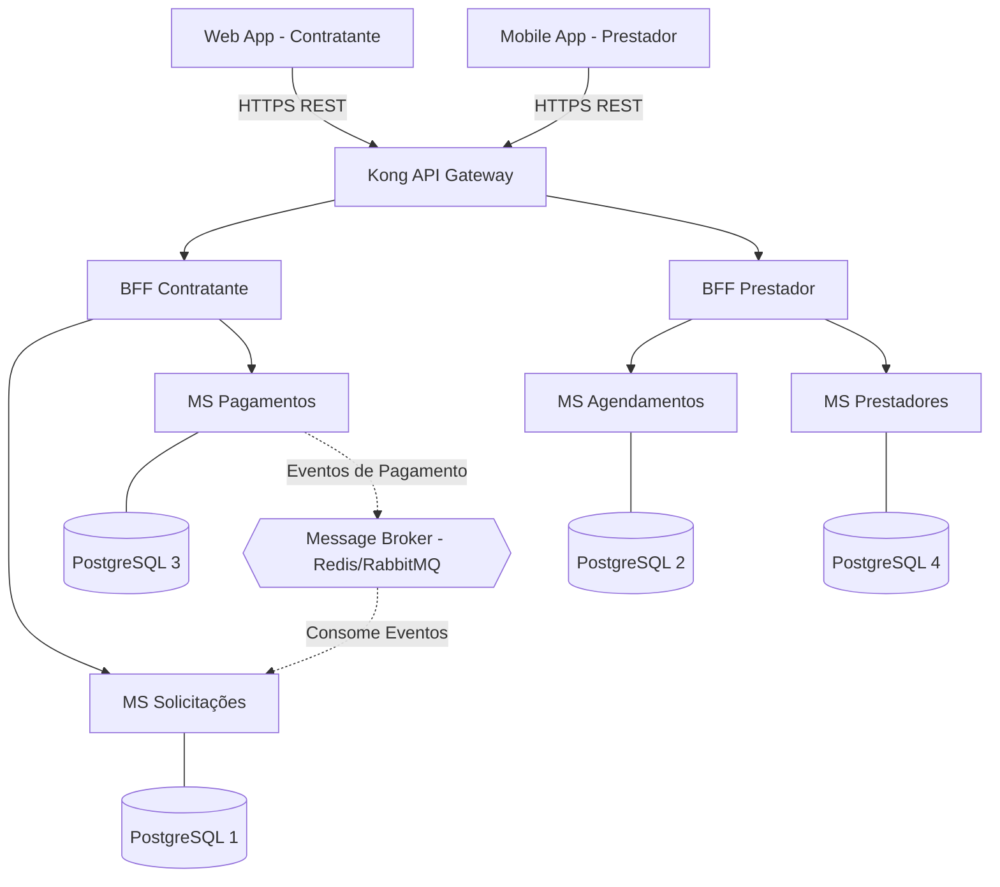

# 1. Decomposição em Microsserviços e Banco de Dados

Esta seção detalha o projeto arquitetural da **ResolveLar**, estabelecendo os limites dos microsserviços de domínio e as estratégias de persistência.

## 1.1 Identificação dos Microsserviços e Responsabilidades
O domínio da plataforma foi decomposto em 5 microsserviços independentes, focados na coesão do negócio:

1. **MS Prestadores:** Gerencia o perfil dos profissionais, especialidades, áreas de atendimento e a agenda estática.
2. **MS Solicitações (e Orçamentos):** Controla a criação de pedidos pelos clientes, o envio de propostas pelos prestadores e atua como o **Orquestrador** da principal SAGA do sistema (confirmação do serviço).
3. **MS Agendamentos:** Responsável por bloquear horários na agenda do prestador e garantir que não haja choque de reservas.
4. **MS Pagamentos:** Processa a autorização do cartão de crédito, captura do valor e liberação do repasse.
5. **MS Avaliações:** Registra o feedback cruzado (cliente/prestador) ao final do serviço e consolida a nota média.

### Justificativa das Fronteiras (Bounded Contexts)
A escolha por este corte, em vez de um monólito ou serviços genéricos (como um "MS Usuários"), baseia-se no princípio de responsabilidade única e na mitigação de falhas em cascata. O domínio de Pagamentos, por exemplo, possui regras rígidas de segurança e transação financeira, e não precisa conhecer a especialidade técnica do prestador. Da mesma forma, se o MS Avaliações ficar indisponível, o sistema deve continuar capaz de processar novos orçamentos (MS Solicitações), isolando o impacto.

---

## 1.2 Diagrama de Componentes e Comunicação

O diagrama abaixo ilustra a comunicação síncrona (via API Gateway REST) e assíncrona (eventos) entre os componentes.

---

## 1.3 Database per Service e Consistência Eventual

Para garantir a autonomia tecnológica e de escala, aplicamos o padrão **Database per Service**. Cada microsserviço possui a sua própria base de dados em contentores **PostgreSQL** isolados.

* **Justificativa:** O PostgreSQL suporta perfeitamente as necessidades relacionais (ex: transações no MS Pagamentos) e buscas indexadas (JSONB para perfis no MS Prestadores), além de impedir que um serviço faça *queries* diretas na base do outro, forçando o uso de contratos de API.

**Pontos de Consistência Eventual:**
O sistema tolera consistência eventual na atualização da reputação do profissional. Quando um serviço é concluído e o MS Avaliações recebe uma nota, emite um evento. O MS Prestadores consome este evento e recalcula a nota média do prestador na sua base de dados. Durante alguns milissegundos, a nota pode estar defasada, o que é aceitável para o domínio de negócio.

---

## 1.4 Análise de Risco de Dual Write e Padrão Outbox

O risco de *dual write* (escrita dupla) ocorre fortemente no **MS Pagamentos**. Ao aprovar uma cobrança, o serviço precisa de:

1. Guardar o estado "PAGO" na sua base de dados (PostgreSQL).
2. Publicar o evento "PagamentoAprovado" no Message Broker para a SAGA continuar.

Se a base de dados fizer *commit*, mas a rede falhar antes de enviar o evento para o Broker, o sistema entra em inconsistência (o cliente pagou, mas a solicitação não avançou).

**Projeto do Transactional Outbox:**
Para evitar isso, utilizaremos o padrão Outbox.

* O MS Pagamentos guarda a transação na tabela `pagamentos` e, na *mesma transação ACID da base de dados*, guarda o payload do evento numa tabela chamada `outbox`.
* Um processo secundário (*Relay Worker*) lê continuamente a tabela `outbox` e publica as mensagens no Broker com garantia *At-Least-Once*. Após a publicação confirmada, o evento é marcado como processado.

---