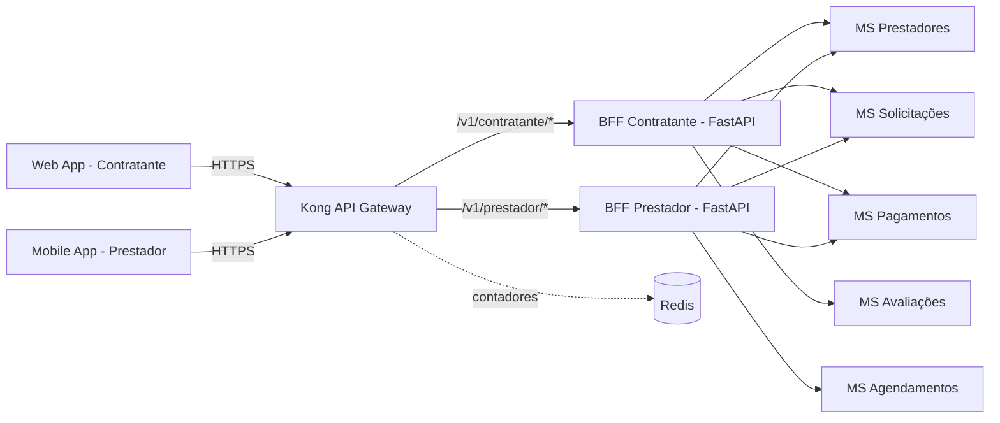

# 2. Gateway e BFF — Entrada da Aplicação

Esta seção detalha como os clientes da **ResolveLar** (Web App do Contratante e Mobile App do Prestador) se conectam ao backend. A entrada da plataforma é composta por duas camadas:

1. **API Gateway (Kong):** ponto único de entrada, responsável pelo roteamento e por preocupações transversais (autenticação e rate limiting).
2. **Backends for Frontend (FastAPI):** um BFF por tipo de cliente, que agrega os dados dos microsserviços de domínio definidos na [Seção 1](01-decomposicao-e-dados.md) e entrega a cada app exatamente o payload de que ele precisa.



> Apenas o Kong é exposto à internet. BFFs e microsserviços ficam numa rede interna e não são acessíveis diretamente pelos clientes.

---

## 2.1 API Gateway: Kong

### Por que o Kong
* **Open source e maduro**, construído sobre o NGINX, com bom desempenho para alto volume de requisições.
* **Ecossistema de plugins** prontos para autenticação (JWT, OAuth2/OIDC), rate limiting, CORS e observabilidade, o que evita reimplementar essas regras em cada BFF.
* **Configuração declarativa** (arquivo `kong.yml` em modo *DB-less*), que pode ser versionada no repositório e levantada junto com os demais contentores via Docker Compose ou Kubernetes.

### Responsabilidades

| Responsabilidade | O que o Kong faz | O que o Kong **não** faz |
|---|---|---|
| Roteamento | Encaminha cada requisição ao BFF correto com base no prefixo da URL. | Não conhece regras de negócio nem chama os microsserviços de domínio. |
| Autenticação | Valida o token JWT (assinatura e expiração) e repassa a identidade do usuário ao BFF via cabeçalhos. | Não emite tokens; isso é papel do provedor de identidade. |
| Autorização por perfil | Garante que um token de contratante só acesse rotas de contratante, e vice-versa (plugin `acl`). | Não decide se o usuário pode ver *aquela* solicitação específica (isso fica no BFF). |
| Rate limiting | Limita requisições por usuário e por rota, protegendo o backend contra abuso e picos de tráfego. | — |
| Transversais | CORS, geração de `X-Correlation-Id` para rastreamento distribuído e logs de acesso. | — |

---

## 2.2 Regras de Roteamento

O Kong expõe um prefixo por tipo de cliente. O versionamento segue a estratégia definida na [Seção 4](04-rest-e-cqrs.md) (`/v1/`, `/v2/`):

| Rota pública (Kong) | Destino interno | Autenticação | Perfil exigido |
|---|---|---|---|
| `POST /auth/*` | Provedor de identidade | Não | — |
| `/v1/contratante/*` | `bff-contratante:8000` | JWT | `contratante` |
| `/v1/prestador/*` | `bff-prestador:8000` | JWT | `prestador` |
| Qualquer outra | — | — | `404 Not Found` |

O Kong remove o prefixo do cliente (`strip_path: true`), então o BFF recebe caminhos limpos, como `/solicitacoes/sol_8f21`.

### Fluxo de uma requisição
1. O Mobile App envia `GET /v1/prestador/tarefas/sol_8f21` com o cabeçalho `Authorization: Bearer <token>`.
2. O Kong **valida o JWT**. Se o token for inválido ou estiver expirado, responde `401 Unauthorized`.
3. O Kong verifica se o usuário pertence ao grupo `prestador`. Se não pertencer, responde `403 Forbidden`.
4. O Kong aplica o **rate limiting**. Se o limite tiver sido excedido, responde `429 Too Many Requests` com o cabeçalho `Retry-After`.
5. O Kong remove o prefixo, injeta os cabeçalhos `X-User-Id`, `X-User-Role` e `X-Correlation-Id` e encaminha para `bff-prestador:8000/tarefas/sol_8f21`.
6. O BFF consulta os microsserviços, monta o payload e o devolve ao app.

---

## 2.3 Rate Limiting

Os limites são aplicados **por consumidor (usuário autenticado)**, com regras mais rígidas em operações sensíveis:

| Rota | Limite | Motivo |
|---|---|---|
| `POST /auth/login` | 5 req/min por IP | Mitigar ataques de força bruta em senhas. |
| `POST /v1/contratante/solicitacoes` | 10 req/hora | Evitar spam de solicitações aos prestadores. |
| `POST /v1/prestador/solicitacoes/{id}/orcamentos` | 30 req/hora | Evitar envio massivo e automatizado de orçamentos. |
| Demais rotas de leitura | 120 req/min | Uso normal do app (listagens e telas de detalhe). |

Os contadores ficam no **Redis** (`policy: redis`), o mesmo componente já previsto como opção de Message Broker na Seção 1. Assim, várias instâncias do Kong compartilham a mesma contagem e o gateway pode escalar horizontalmente.

### Configuração declarativa (exemplo)

```yaml
# kong.yml — modo DB-less
_format_version: "3.0"

services:
  - name: bff-contratante
    url: http://bff-contratante:8000
    routes:
      - name: rota-contratante
        paths: ["/v1/contratante"]
        strip_path: true
    plugins:
      - name: jwt
      - name: acl
        config:
          allow: ["contratante"]
      - name: rate-limiting
        config:
          minute: 120
          limit_by: consumer
          policy: redis
          redis:
            host: redis

  - name: bff-prestador
    url: http://bff-prestador:8000
    routes:
      - name: rota-prestador
        paths: ["/v1/prestador"]
        strip_path: true
    plugins:
      - name: jwt
      - name: acl
        config:
          allow: ["prestador"]
      - name: rate-limiting
        config:
          minute: 120
          limit_by: consumer
          policy: redis
          redis:
            host: redis

plugins:            # plugins globais
  - name: correlation-id
    config:
      header_name: X-Correlation-Id
      generator: uuid
  - name: cors
    config:
      origins: ["https://app.resolvelar.com.br"]
```

---

## 2.4 Backends for Frontend (FastAPI)

### Por que BFF
Os dois apps consomem **os mesmos microsserviços de domínio**, mas precisam de informações muito diferentes. Sem BFF, restariam duas opções ruins:

* **Uma API genérica única**, que devolveria payloads grandes com campos inúteis para cada app (*over-fetching*) ou obrigaria o app a fazer várias chamadas para montar uma única tela (*under-fetching*), o que é custoso em redes móveis.
* **O app chamando os microsserviços diretamente**, acoplando o front-end à divisão interna do backend e expondo serviços internos à internet.

Com o padrão BFF, cada cliente tem um backend sob medida que **agrega, filtra e formata** os dados. O time de cada app pode evoluir a sua API sem impactar o outro.

### Por que FastAPI
* **Assíncrono nativo** (`async/await`): o BFF passa a maior parte do tempo esperando respostas de outros serviços, e o FastAPI permite fazer essas chamadas **em paralelo** com `httpx` + `asyncio.gather`.
* **Contratos com Pydantic**: os modelos de resposta definem exatamente quais campos saem para o app, impedindo o vazamento acidental de dados internos.
* **Documentação OpenAPI automática** (`/docs`), útil para os times de front-end consumirem a API.

### Por que os dois BFFs diferem

| Aspecto | BFF Contratante | BFF Prestador |
|---|---|---|
| Objetivo do usuário | Encontrar, comparar e contratar um profissional. | Avaliar tarefas, executar o serviço e controlar os ganhos. |
| Foco do payload | **Dados resumidos para exibição**: nome, foto, nota, preço final e status legível. | **Detalhes técnicos da tarefa**: descrição completa, especificações, materiais, fotos e janela de horário. |
| Valores financeiros | Apenas o **valor total** que será pago. | **Valor bruto, taxa da plataforma e valor líquido** a receber (vindos do MS Pagamentos). |
| Dados da outra parte | Nome e reputação do prestador; sem contato até o agendamento. | Endereço exato e contato do cliente apenas **após** o agendamento confirmado. |
| Telas principais | Busca de prestadores, comparação de orçamentos, acompanhamento do pedido. | Fila de solicitações, detalhe da tarefa, agenda e extrato financeiro. |
| Microsserviços consultados | Prestadores, Solicitações, Pagamentos, Avaliações. | Solicitações, Agendamentos, Pagamentos, Prestadores. |

> Os valores monetários seguem o contrato da Seção 4 (inteiro em `centavos` + `moeda`). O BFF Contratante acrescenta um campo já formatado para a tela; o BFF Prestador mantém os valores em centavos para permitir somas no extrato.

---

## 2.5 Exemplo de Payload — BFF Contratante

**`GET /v1/contratante/solicitacoes/sol_8f21/orcamentos`** — tela de comparação dos orçamentos recebidos.

```json
{
  "solicitacao_id": "sol_8f21",
  "titulo": "Chuveiro queimado",
  "status": "Aguardando sua escolha",
  "orcamentos": [
    {
      "orcamento_id": "orc_42",
      "prestador": {
        "nome": "Carlos Silva",
        "foto_url": "https://cdn.resolvelar.com.br/p/prest_17.jpg",
        "nota": 4.8,
        "servicos_realizados": 132
      },
      "valor": { "centavos": 18000, "moeda": "BRL" },
      "valor_formatado": "R$ 180,00",
      "prazo": "Amanhã, 14h–16h"
    },
    {
      "orcamento_id": "orc_43",
      "prestador": {
        "nome": "Ana Souza",
        "foto_url": "https://cdn.resolvelar.com.br/p/prest_23.jpg",
        "nota": 4.9,
        "servicos_realizados": 87
      },
      "valor": { "centavos": 15000, "moeda": "BRL" },
      "valor_formatado": "R$ 150,00",
      "prazo": "Hoje, 18h–20h"
    }
  ]
}
```

O payload já vem **pronto para a tela**: status em linguagem natural, valor formatado, prazo legível e apenas as informações necessárias para comparar e escolher. Não há taxa da plataforma, custos internos nem detalhes técnicos.

---

## 2.6 Exemplo de Payload — BFF Prestador

**`GET /v1/prestador/tarefas/sol_8f21`** — tela de detalhe de uma tarefa já agendada.

```json
{
  "tarefa_id": "sol_8f21",
  "categoria": "eletricista",
  "status": "AGENDADA",
  "descricao": "Chuveiro parou de esquentar após queda de energia. Modelo Lorenzetti Advanced 220V, 7500W.",
  "detalhes_tecnicos": {
    "tensao": "220V",
    "potencia_w": 7500,
    "materiais_sugeridos": ["Resistência 7500W 220V", "Fita isolante"],
    "fotos_problema": ["https://cdn.resolvelar.com.br/s/sol_8f21-1.jpg"]
  },
  "agendamento": {
    "inicio": "2026-10-22T17:00:00Z",
    "fim": "2026-10-22T19:00:00Z"
  },
  "local": {
    "endereco": "Rua das Flores, 120, apto 302",
    "bairro": "Centro",
    "cidade": "Lavras",
    "referencia": "Portão azul, interfone 302"
  },
  "cliente": {
    "nome": "Mariana",
    "telefone": "+55 35 99999-0000"
  },
  "financeiro": {
    "moeda": "BRL",
    "valor_bruto_centavos": 18000,
    "taxa_plataforma_percentual": 12.0,
    "taxa_plataforma_centavos": 2160,
    "valor_liquido_centavos": 15840,
    "previsao_repasse": "2026-10-24"
  }
}
```

Aqui o foco é **executar o serviço e saber quanto vai receber**: especificações técnicas para levar o material certo, endereço e contato liberados após a confirmação, datas em ISO 8601 (UTC) para integração com a agenda do celular e a decomposição financeira até o **valor líquido**.

---

## 2.7 Como o BFF Agrega os Dados

Esboço do endpoint do BFF Prestador, que consulta três microsserviços em paralelo e monta o payload acima:

```python
# bff_prestador/main.py
import asyncio
import httpx
from fastapi import FastAPI, Header, HTTPException

app = FastAPI(title="BFF Prestador")

MS_SOLICITACOES = "http://ms-solicitacoes:8000"
MS_AGENDAMENTOS = "http://ms-agendamentos:8000"
MS_PAGAMENTOS = "http://ms-pagamentos:8000"


@app.get("/tarefas/{tarefa_id}")
async def detalhe_tarefa(tarefa_id: str, x_user_id: str = Header(...)):
    async with httpx.AsyncClient(timeout=2.0) as client:
        solicitacao, agendamento, repasse = await asyncio.gather(
            client.get(f"{MS_SOLICITACOES}/v1/solicitacoes/{tarefa_id}"),
            client.get(f"{MS_AGENDAMENTOS}/v1/agendamentos", params={"solicitacao_id": tarefa_id}),
            client.get(f"{MS_PAGAMENTOS}/v1/repasses", params={"solicitacao_id": tarefa_id}),
        )

    solicitacao = solicitacao.json()
    if solicitacao["prestador_id"] != x_user_id:  # identidade injetada pelo Kong
        raise HTTPException(status_code=403)

    return {
        **resumo_tecnico(solicitacao),
        "agendamento": agendamento.json(),
        "financeiro": repasse.json(),  # bruto, taxa e líquido calculados pelo MS Pagamentos
    }
```

Pontos importantes:
* O BFF **confia na identidade** repassada pelo Kong (`X-User-Id`), sem revalidar o JWT, pois só é acessível pela rede interna.
* A **autorização fina** (o prestador só vê tarefas que são dele) fica no BFF, já que o Kong não conhece regras de negócio.
* O cálculo da taxa e do valor líquido **pertence ao MS Pagamentos**; o BFF apenas repassa o resultado, sem duplicar regra financeira.
* As chamadas são **paralelas** e com **timeout curto**, para que um serviço lento não trave a tela do app. Se o MS Avaliações ou o MS Pagamentos estiver indisponível, o BFF pode devolver a tela sem aquele bloco em vez de falhar por inteiro, seguindo o isolamento de falhas descrito na Seção 1.
* O BFF **não possui banco de dados próprio**: é uma camada de composição sem estado, o que facilita a escala horizontal.

---

## 2.8 Resumo

| Camada | Tecnologia | Papel |
|---|---|---|
| API Gateway | Kong | Porta de entrada única: roteia por prefixo, valida JWT, aplica ACL por perfil e rate limiting. |
| BFF Contratante | FastAPI | Entrega dados resumidos e prontos para exibição, focados em comparar e contratar. |
| BFF Prestador | FastAPI | Entrega detalhes técnicos da tarefa e a decomposição financeira até o valor líquido. |

Essa separação mantém o gateway simples e genérico, enquanto cada BFF evolui conforme as necessidades da sua própria interface, sem expor os microsserviços de domínio diretamente aos clientes.
