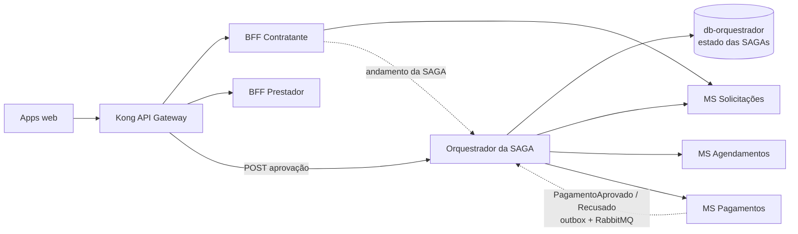

# 3. SAGA Orquestrada — Aceite de Orçamento

## 3.1 Objetivo e contexto

Na **ResolveLar**, o aceite de um orçamento não é uma única operação de banco de dados. Para confirmar um serviço de manutenção residencial, a plataforma precisa **registrar a decisão do contratante**, **reservar um horário do prestador** e **processar o pagamento**. Essas operações pertencem a microsserviços com bancos PostgreSQL independentes, conforme definido em [`01-decomposicao-e-dados.md`](01-decomposicao-e-dados.md).

Quem coordena essa transação é o **Orquestrador da SAGA** (`orquestrador-saga`), um componente **fora dos microsserviços de domínio**. Ele não guarda pedidos, orçamentos, reservas nem pagamentos: só comanda os participantes e acompanha o andamento. Cada microsserviço continua dono apenas do seu domínio.

| Componente | Papel na SAGA | Estado/resultado local |
|---|---|---|
| **Orquestrador da SAGA** | Recebe o aceite (vindo do gateway), registra o `sagaId`, comanda as etapas na ordem, decide as compensações e consolida o resultado. Não tem dados de domínio. | SAGA `EM_ANDAMENTO`, `CONCLUIDA`, `COMPENSADA`, `COMPENSACAO_PENDENTE`, `REJEITADA` ou `ABORTADA` (banco próprio `db-orquestrador`). |
| **MS Solicitações (e Orçamentos)** | Participante: valida dono e orçamento, trava a solicitação para a SAGA e, no fim, a confirma ou destrava. | Solicitação `EM_CONFIRMACAO`, depois `CONFIRMADA` ou `AGUARDANDO_ACEITE`. |
| **MS Agendamentos** | Participante: impede conflitos de agenda; cria uma reserva temporária, confirma ou libera a vaga. | Reserva `RESERVADA`, `CONFIRMADA` ou `LIBERADA`. |
| **MS Pagamentos** | Participante: realiza o processamento financeiro, registra o resultado e publica eventos confiáveis (outbox). | Pagamento `APROVADO`, `RECUSADO` ou `ESTORNADO`. |

**Regra de negócio:** o serviço só é considerado **confirmado** quando a reserva estiver confirmada e o pagamento estiver aprovado. Enquanto isso, o aplicativo apresenta um status de processamento, sem informar incorretamente que o atendimento já está garantido.

### Onde o orquestrador fica



A aprovação **sai do gateway direto para o orquestrador** (rota `POST /v1/contratante/orcamentos/{id}/aprovacao` no Kong). As demais telas continuam passando pelos BFFs. O BFF do contratante só **lê** o andamento da SAGA no orquestrador para mostrar a etapa ao usuário.

## 3.2 Por que SAGA orquestrada (e não coreografada)? E por que um orquestrador separado?

A opção adotada é **somente a SAGA orquestrada**. O orquestrador conhece a ordem das etapas, acompanha os resultados e decide quando executar compensações.

Na alternativa **coreografada**, cada serviço reagiria autonomamente a eventos para iniciar a próxima etapa. Embora isso reduza a dependência de um coordenador, espalha a lógica de compensação por vários serviços e dificulta identificar o estado final da operação. Para um fluxo curto e crítico, envolvendo agenda e dinheiro, a orquestração oferece **maior rastreabilidade e clareza na recuperação de falhas**.

**Por que fora do MS Solicitações:** numa versão anterior, o próprio MS Solicitações era o orquestrador. Isso misturava dois papéis num microsserviço de domínio: cuidar de pedidos e orçamentos **e** coordenar outros serviços. O MS Solicitações passava a conhecer agenda, pagamento, broker e compensações, que não são do seu domínio. Com o orquestrador separado:

- cada microsserviço tem só o seu domínio e expõe comandos simples e idempotentes;
- o MS Solicitações vira um **participante** como os outros, comandado pelo orquestrador;
- o fluxo da contratação fica em um único lugar, fácil de ler, testar e mostrar no diagrama.

**Trade-off:** o orquestrador passa a ser um componente importante para o fluxo. Por isso, seu estado é persistido em **banco próprio** (`db-orquestrador`), permitindo continuar uma SAGA interrompida após reinício, e todos os comandos dos participantes são idempotentes pelo `sagaId`.

## 3.3 Contrato de entrada e estados

O contratante inicia a confirmação pelo app web. A requisição passa pelo **Kong**, que valida o JWT e o perfil e a encaminha ao **orquestrador**:

```http
POST /v1/contratante/orcamentos/orc_42/aprovacao
Authorization: Bearer <JWT>
Content-Type: application/json
Idempotency-Key: aceite-orc_42-contratante_15
```

```json
{
  "horarioEscolhido": "2026-10-28T14:00:00Z",
  "meioPagamentoId": "pm_tok_123"
}
```

O Kong reescreve o caminho para `POST /v1/orcamentos/orc_42/aprovacao` no orquestrador e envia a identidade (`X-User-Id` tirado do `sub` do token, `X-User-Role: contratante`). O orquestrador:

1. registra a SAGA (`INICIAR`) com a `Idempotency-Key` antes de qualquer efeito;
2. pede ao **MS Solicitações** que **inicie a contratação** daquele orçamento: o serviço confere se o orçamento é do contratante, se está pendente e dentro da validade, e trava a solicitação (`EM_CONFIRMACAO`) para esta SAGA;
3. responde **`202 Accepted`** e segue as demais etapas em segundo plano.

O identificador do meio de pagamento representa um **token**, nunca dados brutos de cartão.

```json
{
  "sagaId": "saga_52",
  "solicitacaoId": "sol_8f21",
  "orcamentoId": "orc_42",
  "status": "EM_CONFIRMACAO",
  "_links": {
    "acompanhar": {
      "href": "/v1/contratante/solicitacoes/sol_8f21",
      "method": "GET"
    }
  }
}
```

Erros de negócio voltam na hora, porque o primeiro passo é síncrono: orçamento de outro contratante → **`403`**; vencido, recusado ou já consumido → **`409 Conflict`**; horário no passado → **`422`**. Se o MS Solicitações estiver fora do ar, o orquestrador responde **`503`** e desfaz o que possa ter sido feito (etapa `ABORTAR`). A consulta da solicitação informa o resultado final: `CONFIRMADA`, ou `AGUARDANDO_ACEITE` acompanhada do motivo da falha.

## 3.4 Caminho feliz — confirmação bem-sucedida

1. O **contratante aceita um orçamento**, informando o horário e um meio de pagamento tokenizado. O Kong encaminha o comando ao **orquestrador**.
2. O **orquestrador** registra a SAGA e pede ao **MS Solicitações** que inicie a contratação; a solicitação fica `EM_CONFIRMACAO`. O orquestrador retorna `202 Accepted`.
3. O orquestrador envia ao **MS Agendamentos** o comando para reservar o horário. O serviço verifica conflitos e registra a vaga como `RESERVADA`, devolvendo `reservaId`.
4. O orquestrador envia ao **MS Pagamentos** a solicitação de pagamento. Ao aprovar a operação, o serviço grava o pagamento `APROVADO` e o evento `PagamentoAprovado` na tabela **outbox**, na **mesma transação local ACID**.
5. Um **Outbox Relay** publica `PagamentoAprovado` no **RabbitMQ**. O orquestrador consome o evento (correlacionado pelo `sagaId`).
6. O orquestrador pede ao **MS Agendamentos** que confirme a reserva. A reserva passa a `CONFIRMADA`.
7. O orquestrador pede ao **MS Solicitações** que confirme a contratação: a solicitação passa a `CONFIRMADA` com o prestador. A SAGA fica `CONCLUIDA`.

### Diagrama de sequência — sucesso

```mermaid
sequenceDiagram
    autonumber
    actor Cliente as Contratante
    participant GW as Kong (Gateway)
    participant ORQ as Orquestrador da SAGA
    participant SOL as MS Solicitacoes
    participant AGEN as MS Agendamentos
    participant PAG as MS Pagamentos
    participant BUS as Outbox Relay / RabbitMQ
    participant BFF as BFF Contratante

    Cliente->>GW: POST /v1/contratante/orcamentos/{id}/aprovacao
    GW->>ORQ: POST /v1/orcamentos/{id}/aprovacao (JWT validado)
    ORQ->>ORQ: Registrar SAGA (Idempotency-Key)
    ORQ->>SOL: Iniciar contratacao (sagaId)
    SOL->>SOL: Validar dono e orcamento; EM_CONFIRMACAO
    SOL-->>ORQ: prestador, valor, duracao
    ORQ-->>GW: 202 Accepted (sagaId)
    GW-->>Cliente: Confirmacao em processamento

    ORQ->>AGEN: Reservar horario (sagaId)
    AGEN->>AGEN: Gravar reserva RESERVADA
    AGEN-->>ORQ: reservaId, RESERVADA
    ORQ->>PAG: Processar pagamento (sagaId)
    PAG->>PAG: Gravar APROVADO e evento na outbox
    PAG-->>ORQ: Processamento aceito
    PAG->>BUS: Relay publica PagamentoAprovado
    BUS-->>ORQ: PagamentoAprovado(sagaId)
    ORQ->>AGEN: Confirmar reserva (reservaId)
    AGEN-->>ORQ: CONFIRMADA
    ORQ->>SOL: Confirmar contratacao (sagaId)
    SOL-->>ORQ: Solicitacao CONFIRMADA
    ORQ->>ORQ: SAGA CONCLUIDA

    Cliente->>GW: GET /v1/contratante/solicitacoes/{id}
    GW->>BFF: GET /solicitacoes/{id}
    BFF->>SOL: Consultar estado
    BFF->>ORQ: Consultar andamento da SAGA
    BFF-->>Cliente: Exibir servico confirmado
```

> O relay é representado junto do broker apenas para simplificar a leitura do diagrama. A gravação da **outbox ocorre dentro do banco do MS Pagamentos**, e o relay publica depois.

## 3.5 Cenário de falha — pagamento recusado

Suponha que o MS Agendamentos **já reservou a vaga**, mas a operadora recuse o pagamento. Manter o horário bloqueado impediria outro contratante de utilizá-lo, mesmo sem contratação válida. O orquestrador precisa, portanto, executar **transações compensatórias**.

1. O MS Pagamentos registra o resultado `RECUSADO` e publica, via outbox/broker, o evento `PagamentoRecusado` (mesmo mecanismo do evento de sucesso).
2. O orquestrador recebe `PagamentoRecusado` e identifica, pelo `sagaId`, qual reserva deve ser desfeita.
3. O orquestrador envia ao MS Agendamentos **`LiberarReserva(reservaId)`**, que marca a reserva `LIBERADA` e devolve a disponibilidade do horário.
4. O orquestrador pede ao MS Solicitações que **cancele a contratação**: a solicitação volta de `EM_CONFIRMACAO` para `AGUARDANDO_ACEITE` (com o motivo) e o orçamento volta a ficar pendente. A SAGA fica `COMPENSADA`. O orçamento pode ser tentado de novo, se ainda estiver válido.
5. O app informa ao cliente que a confirmação **não foi concluída** porque o pagamento não foi autorizado.

### Diagrama de sequência — falha com compensação

```mermaid
sequenceDiagram
    autonumber
    actor Cliente as Contratante
    participant GW as Kong (Gateway)
    participant ORQ as Orquestrador da SAGA
    participant SOL as MS Solicitacoes
    participant AGEN as MS Agendamentos
    participant PAG as MS Pagamentos
    participant BUS as Outbox Relay / RabbitMQ

    Cliente->>GW: POST /v1/contratante/orcamentos/{id}/aprovacao
    GW->>ORQ: POST /v1/orcamentos/{id}/aprovacao
    ORQ->>SOL: Iniciar contratacao (sagaId)
    SOL-->>ORQ: EM_CONFIRMACAO
    ORQ-->>GW: 202 Accepted
    GW-->>Cliente: Confirmacao em processamento

    ORQ->>AGEN: Reservar horario (sagaId)
    AGEN-->>ORQ: reservaId, RESERVADA
    ORQ->>PAG: Processar pagamento (sagaId)
    PAG->>PAG: Gravar RECUSADO e evento na outbox
    PAG->>BUS: Relay publica PagamentoRecusado
    BUS-->>ORQ: PagamentoRecusado(sagaId)

    Note over ORQ,SOL: COMPENSACAO: desfazer na ordem inversa
    ORQ->>AGEN: LiberarReserva(reservaId)
    AGEN->>AGEN: Marcar LIBERADA e devolver a vaga
    AGEN-->>ORQ: Reserva liberada
    ORQ->>SOL: Cancelar contratacao (sagaId, motivo)
    SOL->>SOL: Voltar a AGUARDANDO_ACEITE
    SOL-->>ORQ: Solicitacao destravada
    ORQ->>ORQ: SAGA COMPENSADA

    Cliente->>GW: GET /v1/contratante/solicitacoes/{id}
    GW-->>Cliente: Pagamento nao autorizado; pode tentar de novo
```

## 3.6 Transações compensatórias e outras falhas

A SAGA não realiza um `ROLLBACK` global entre os bancos: cada serviço confirma sua própria transação e, quando necessário, executa **novas operações de negócio que desfazem os efeitos anteriores**. Todas as etapas abaixo são do orquestrador (`services/orquestrador-saga/app/worker.py`).

| Ponto de falha | Efeitos já realizados | Compensação comandada pelo orquestrador |
|---|---|---|
| **MS Solicitações fora do ar ao iniciar** | Talvez a solicitação tenha sido travada (resposta perdida). | Responder `503` e **cancelar a contratação** (idempotente: só desfaz se a solicitação estiver com esta SAGA). SAGA `ABORTADA`. |
| **Horário indisponível** | Solicitação `EM_CONFIRMACAO`; nenhum pagamento foi iniciado. | **Cancelar a contratação** no MS Solicitações; não há reserva para liberar. |
| **Pagamento recusado** | Reserva `RESERVADA`; não houve cobrança aprovada. | **Liberar a reserva** no MS Agendamentos e **cancelar a contratação** no MS Solicitações. |
| **Pagamento aprovado, mas a confirmação da reserva (ou da solicitação) falha** | Reserva provisória + pagamento aprovado. | **Estornar o pagamento**, depois **liberar a reserva** e **cancelar a contratação**. |
| **Falha transitória em qualquer passo** | Depende da etapa. | **Repetir com backoff** (até 60 s); os comandos são idempotentes pelo `sagaId`. |
| **Falha na própria compensação** | Alguma etapa permanece pendente de reversão. | SAGA `COMPENSACAO_PENDENTE`, novas tentativas com *backoff*; nunca anunciar a compensação como concluída antes da confirmação remota. |

Em particular, **estornar um pagamento não é o mesmo que desfazer uma linha de banco**: pode depender do provedor externo e levar algum tempo. O orquestrador acompanha essa operação até sua conclusão.

## 3.7 Confiabilidade, consistência e rastreabilidade

- **Idempotência:** todos os comandos levam o `sagaId` (e, na entrada pública, `Idempotency-Key`). Repetir uma requisição ou consumir um evento duplicado não reserva duas vagas nem faz duas cobranças. Uma aprovação rejeitada (403/409) guarda a resposta e devolve a mesma ao repetir a chave.
- **Correlação e persistência:** o orquestrador guarda no `db-orquestrador` o `sagaId`, a etapa atual, `reservaId`, `pagamentoId`, resultados e tentativas. Após reiniciar, ele retoma processos incompletos sem repetir efeitos indevidos. Uma SAGA presa em `INICIAR` (queda no meio da requisição) é abortada após 30 s.
- **Outbox e entrega pelo menos uma vez:** o MS Pagamentos escreve seu estado e o evento numa transação local; o relay publica no RabbitMQ (fila `resolvelar.orquestrador.pagamentos`). Como mensagens podem chegar duplicadas, o orquestrador controla os eventos processados por `eventId` (inbox).
- **Timeout não significa pagamento recusado:** diante de resposta desconhecida do MS Pagamentos, o orquestrador consulta o pagamento pelo `sagaId` **antes de repetir ou de liberar a reserva**. Isso evita liberar um horário quando o pagamento pode ter sido efetivado.
- **Consistência eventual:** durante a SAGA, os bancos podem mostrar estados intermediários diferentes. O app usa o status da solicitação (MS Solicitações) e o andamento da SAGA (orquestrador), e não considera o serviço confirmado antes da conclusão.
- **Observabilidade:** o orquestrador registra em log cada etapa com `sagaId`, status e `correlationId`.

## 3.8 Alinhamento com os demais documentos

A arquitetura preserva os microsserviços, o PostgreSQL por serviço e o evento **`PagamentoAprovado` via outbox** definidos em `01-decomposicao-e-dados.md`. O evento **`PagamentoRecusado`** e os comandos de compensação (**`LiberarReserva`**, estorno e cancelamento da contratação) cobrem o cenário de falha exigido.

**Mudança após a devolutiva da Parte 2:** o papel de orquestrador saiu do MS Solicitações para o componente próprio `orquestrador-saga`, ligado ao gateway. O MS Solicitações ficou só com o domínio (pedidos e orçamentos) e ganhou três comandos internos usados pela SAGA: `POST /v1/orcamentos/{id}/contratacao` (iniciar), `.../contratacao/confirmacao` e `.../contratacao/cancelamento`.
