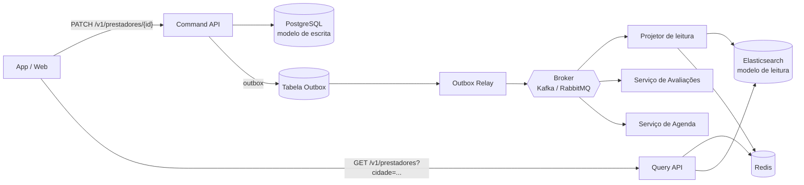

# ResolveLar — REST, HATEOAS e CQRS

Documento de arquitetura da API do ResolveLar, plataforma que conecta clientes a prestadores de serviços de manutenção residencial.

---

## 1. Contratos REST

### 1.1 Princípios

- **Recursos no plural e em substantivos:** `/prestadores`, `/solicitacoes`, `/orcamentos`.
- **Verbos HTTP com semântica padrão:** `GET` lê, `POST` cria, `PUT` substitui, `PATCH` altera parcialmente, `DELETE` remove.
- **Versionamento na URI:** todo contrato público começa com `/v1/`. Mudanças que quebram compatibilidade vão para `/v2/`, mantendo a `/v1/` ativa durante um período de depreciação anunciado (header `Deprecation` e `Sunset`).
- **Formato:** `application/json`, datas em ISO 8601 (UTC), valores monetários em centavos (inteiro) com campo `moeda`.
- **Autenticação:** `Authorization: Bearer <JWT>`.
- **Erros:** padrão [RFC 7807](https://datatracker.ietf.org/doc/html/rfc7807) (`application/problem+json`).

### 1.2 Tabela de endpoints

| Recurso | Verbo | Rota | Descrição | Sucesso | Erros comuns |
|---|---|---|---|---|---|
| Prestadores | `GET` | `/v1/prestadores?cidade=Lavras&categoria=eletricista&page=1&size=20` | Busca profissionais por região/categoria | `200 OK` | `400`, `401` |
| Prestadores | `GET` | `/v1/prestadores/{id}` | Detalha um prestador | `200 OK` | `404` |
| Prestadores | `POST` | `/v1/prestadores` | Cadastra prestador | `201 Created` + `Location` | `400`, `409`, `422` |
| Prestadores | `PATCH` | `/v1/prestadores/{id}` | Atualiza perfil parcialmente | `200 OK` | `400`, `403`, `404` |
| Prestadores | `DELETE` | `/v1/prestadores/{id}` | Desativa o cadastro | `204 No Content` | `403`, `404` |
| Solicitações | `POST` | `/v1/solicitacoes` | Cliente abre um pedido de serviço | `201 Created` + `Location` | `400`, `422` |
| Solicitações | `GET` | `/v1/solicitacoes/{id}` | Consulta pedido | `200 OK` | `403`, `404` |
| Solicitações | `GET` | `/v1/solicitacoes?status=aberta` | Lista pedidos do usuário | `200 OK` | `401` |
| Orçamentos | `POST` | `/v1/solicitacoes/{id}/orcamentos` | Prestador envia orçamento | `201 Created` | `403`, `404`, `409` |
| Orçamentos | `GET` | `/v1/orcamentos/{id}` | Consulta orçamento | `200 OK` | `404` |
| Orçamentos | `POST` | `/v1/orcamentos/{id}/aprovacao` | Cliente aprova | `200 OK` | `403`, `404`, `409` |
| Orçamentos | `POST` | `/v1/orcamentos/{id}/recusa` | Cliente recusa | `200 OK` | `403`, `404`, `409` |
| Avaliações | `POST` | `/v1/solicitacoes/{id}/avaliacao` | Cliente avalia o serviço concluído | `201 Created` | `403`, `409`, `422` |

> Aprovar e recusar são modelados como sub-recursos acionados por `POST` (ações de domínio), não como `PUT` no campo `status`. Assim a regra de negócio fica explícita e o servidor controla as transições válidas.

### 1.3 Status HTTP usados

| Código | Quando usar |
|---|---|
| `200 OK` | Leitura ou ação bem-sucedida com corpo de resposta |
| `201 Created` | Recurso criado; devolver header `Location` |
| `202 Accepted` | Comando aceito para processamento assíncrono |
| `204 No Content` | Sucesso sem corpo (ex.: `DELETE`) |
| `400 Bad Request` | JSON malformado ou parâmetro inválido |
| `401 Unauthorized` | Token ausente ou inválido |
| `403 Forbidden` | Autenticado, mas sem permissão (ex.: cliente tentando aprovar orçamento de outro) |
| `404 Not Found` | Recurso inexistente |
| `409 Conflict` | Transição inválida (ex.: aprovar orçamento já recusado ou expirado) |
| `422 Unprocessable Entity` | Corpo válido, mas viola regra de negócio/validação |
| `429 Too Many Requests` | Limite de requisições excedido |
| `500` / `503` | Falha interna / serviço indisponível |

### 1.4 Exemplo: criar solicitação

**Requisição**

```http
POST /v1/solicitacoes HTTP/1.1
Host: api.resolvelar.com.br
Authorization: Bearer <JWT>
Content-Type: application/json

{
  "categoria": "eletricista",
  "descricao": "Chuveiro não esquenta e disjuntor desarma",
  "endereco": {
    "cep": "37200-000",
    "cidade": "Lavras",
    "uf": "MG"
  },
  "janelaPreferida": "2026-10-28T14:00:00Z"
}
```

**Resposta**

```http
HTTP/1.1 201 Created
Location: /v1/solicitacoes/sol_8f21
Content-Type: application/json

{
  "id": "sol_8f21",
  "status": "ABERTA",
  "criadaEm": "2026-10-21T15:04:00Z"
}
```

### 1.5 Exemplo: erro (RFC 7807)

```http
HTTP/1.1 409 Conflict
Content-Type: application/problem+json

{
  "type": "https://api.resolvelar.com.br/erros/orcamento-nao-pendente",
  "title": "Orçamento não está pendente",
  "status": 409,
  "detail": "O orçamento orc_42 já foi recusado e não pode ser aprovado.",
  "instance": "/v1/orcamentos/orc_42/aprovacao"
}
```

### 1.6 Estratégia de versionamento

| Regra | Detalhe |
|---|---|
| Versão na URI | `/v1/...`, `/v2/...` |
| Mudança compatível (campo novo opcional, endpoint novo) | Não gera nova versão |
| Mudança incompatível (remover/renomear campo, mudar semântica) | Nova versão major |
| Depreciação | Headers `Deprecation: true` e `Sunset: <data>`, com aviso mínimo de 6 meses |
| Clientes | App web e mobile devem tolerar campos desconhecidos na resposta (*tolerant reader*) |

---

## 2. HATEOAS: aprovando ou recusando o orçamento

Com HATEOAS, a resposta diz ao cliente **quais ações são possíveis agora**. O front-end não precisa decidir sozinho se mostra o botão "Aprovar". Ele só renderiza o botão se o link existir.

### 2.1 Orçamento pendente

**Requisição**

```http
GET /v1/orcamentos/orc_42 HTTP/1.1
Authorization: Bearer <JWT-do-cliente>
Accept: application/hal+json
```

**Resposta**

```json
{
  "id": "orc_42",
  "solicitacaoId": "sol_8f21",
  "status": "PENDENTE",
  "valor": {
    "centavos": 18000,
    "moeda": "BRL"
  },
  "descricaoServico": "Troca de resistência do chuveiro e revisão do disjuntor",
  "prazoEstimadoDias": 2,
  "validoAte": "2026-10-25T23:59:59Z",
  "prestador": {
    "id": "prest_17",
    "nome": "Carlos Eletricista",
    "notaMedia": 4.8
  },
  "_links": {
    "self": {
      "href": "/v1/orcamentos/orc_42",
      "method": "GET"
    },
    "aprovar": {
      "href": "/v1/orcamentos/orc_42/aprovacao",
      "method": "POST",
      "title": "Aprovar orçamento"
    },
    "recusar": {
      "href": "/v1/orcamentos/orc_42/recusa",
      "method": "POST",
      "title": "Recusar orçamento"
    },
    "solicitacao": {
      "href": "/v1/solicitacoes/sol_8f21",
      "method": "GET"
    },
    "prestador": {
      "href": "/v1/prestadores/prest_17",
      "method": "GET"
    }
  }
}
```

### 2.2 Mesmo orçamento depois de aprovado

Os links `aprovar` e `recusar` **desaparecem**, e surgem os links do próximo passo do fluxo:

```json
{
  "id": "orc_42",
  "status": "APROVADO",
  "valor": { "centavos": 18000, "moeda": "BRL" },
  "aprovadoEm": "2026-10-22T10:12:00Z",
  "_links": {
    "self": {
      "href": "/v1/orcamentos/orc_42",
      "method": "GET"
    },
    "agendamento": {
      "href": "/v1/solicitacoes/sol_8f21/agendamento",
      "method": "POST",
      "title": "Agendar visita"
    },
    "chat": {
      "href": "/v1/solicitacoes/sol_8f21/mensagens",
      "method": "GET"
    }
  }
}
```

### 2.3 Orçamento expirado

```json
{
  "id": "orc_42",
  "status": "EXPIRADO",
  "_links": {
    "self": { "href": "/v1/orcamentos/orc_42", "method": "GET" },
    "novoOrcamento": {
      "href": "/v1/solicitacoes/sol_8f21/orcamentos",
      "method": "GET",
      "title": "Ver outros orçamentos"
    }
  }
}
```

### 2.4 Benefícios

| Benefício | Efeito no ResolveLar |
|---|---|
| Regras de transição no servidor | Front-end não duplica a lógica de "quando pode aprovar" |
| Menos acoplamento a URLs | Rotas podem mudar sem quebrar app mobile antigo |
| Descoberta do fluxo | Cada resposta indica o próximo passo |
| Autorização refletida | Link só aparece se o usuário tem permissão para a ação |

---

## 3. CQRS no microsserviço de Prestadores

### 3.1 Por que separar leitura e escrita

No ResolveLar, o perfil do prestador é **atualizado raramente** (mudança de telefone, categorias, área de atuação), mas é **consultado o tempo todo**: todo cliente que abre uma solicitação dispara busca de profissionais por região e categoria.

| Característica | Escrita (Command) | Leitura (Query) |
|---|---|---|
| Frequência | Baixa (dezenas por hora) | Altíssima (milhares por minuto no pico) |
| Foco | Consistência e regras de negócio | Latência baixa e filtros flexíveis |
| Modelo ideal | Normalizado, com agregados | Desnormalizado, pronto para exibir |
| Tecnologia indicada | PostgreSQL | Elasticsearch/OpenSearch (busca geográfica e por texto), com cache Redis |
| Escala | Vertical/moderada | Horizontal, com réplicas |

Sem CQRS, a busca com `JOIN` entre prestadores, categorias, regiões, avaliações e disponibilidade competiria com as escritas no mesmo banco. Com CQRS, cada lado escala e evolui de forma independente.

### 3.2 Arquitetura



### 3.3 Lado do comando (escrita)

Endpoints e comandos:

| Endpoint | Comando | Evento publicado |
|---|---|---|
| `POST /v1/prestadores` | `CadastrarPrestador` | `PrestadorCadastrado` |
| `PATCH /v1/prestadores/{id}` | `AtualizarPerfilPrestador` | `PerfilPrestadorAtualizado` |
| `PUT /v1/prestadores/{id}/areas-atendimento` | `DefinirAreasAtendimento` | `AreasAtendimentoAlteradas` |
| `DELETE /v1/prestadores/{id}` | `DesativarPrestador` | `PrestadorDesativado` |

O comando valida as regras, grava no banco de escrita e **na mesma transação** grava o evento na tabela *outbox*. Isso evita o problema de salvar no banco mas falhar ao publicar a mensagem.

### 3.4 Modelo de leitura desnormalizado

Documento único, pronto para a tela de resultados, sem `JOIN`:

```json
{
  "prestadorId": "prest_17",
  "nome": "Carlos Eletricista",
  "fotoUrl": "https://cdn.resolvelar.com.br/prestadores/prest_17.jpg",
  "categorias": ["eletricista", "instalador"],
  "cidade": "Lavras",
  "uf": "MG",
  "bairrosAtendidos": ["Centro", "Jardim Glória", "Vila Barão"],
  "localizacao": { "lat": -21.2453, "lon": -44.9999 },
  "raioAtendimentoKm": 15,
  "notaMedia": 4.8,
  "totalAvaliacoes": 132,
  "servicosConcluidos": 210,
  "disponivelHoje": true,
  "precoMedioCentavos": 15000,
  "ativo": true,
  "versao": 27,
  "atualizadoEm": "2026-10-21T14:58:00Z"
}
```

Os campos `notaMedia`, `totalAvaliacoes`, `servicosConcluidos` e `disponivelHoje` não pertencem ao agregado de Prestadores. Vêm de outros serviços e são **copiados** para o modelo de leitura via eventos. É isso que torna a busca rápida.

### 3.5 Como o modelo de leitura é atualizado via eventos

**Fluxo passo a passo**

1. O prestador altera o perfil: `PATCH /v1/prestadores/prest_17`.
2. A **Command API** valida e grava no PostgreSQL.
3. Na mesma transação, grava `PerfilPrestadorAtualizado` na tabela **outbox**.
4. O **Outbox Relay** lê a outbox e publica o evento no **broker**.
5. O **Projetor de leitura** consome o evento e faz *upsert* parcial no Elasticsearch.
6. O projetor **invalida a chave no Redis** (`prestador:prest_17` e caches de busca da região).
7. A **Query API** passa a devolver os dados novos.

**Exemplo de evento**

```json
{
  "eventId": "evt_9c3a",
  "tipo": "PerfilPrestadorAtualizado",
  "versaoAgregado": 27,
  "ocorridoEm": "2026-10-21T14:58:00Z",
  "dados": {
    "prestadorId": "prest_17",
    "categorias": ["eletricista", "instalador"],
    "bairrosAtendidos": ["Centro", "Jardim Glória", "Vila Barão"],
    "raioAtendimentoKm": 15
  }
}
```

**Eventos de outros serviços que alimentam a projeção**

| Evento | Origem | Campo atualizado no modelo de leitura |
|---|---|---|
| `AvaliacaoRegistrada` | Serviço de Avaliações | `notaMedia`, `totalAvaliacoes` |
| `ServicoConcluido` | Serviço de Solicitações | `servicosConcluidos` |
| `DisponibilidadeAlterada` | Serviço de Agenda | `disponivelHoje` |
| `PrestadorDesativado` | Serviço de Prestadores | `ativo = false` (sai da busca) |

**Projetor idempotente (pseudocódigo)**

```text
ao receber evento E:
    se E.eventId já foi processado:
        ignorar                                  # idempotência

    doc = leitura.obter(E.dados.prestadorId)

    se doc existe e E.versaoAgregado <= doc.versao:
        ignorar                                  # evento antigo ou duplicado

    leitura.upsert_parcial(E.dados.prestadorId, campos_de(E), versao = E.versaoAgregado)
    cache.invalidar("prestador:" + E.dados.prestadorId)
    registrar_processado(E.eventId)
```

### 3.6 Consistência eventual

O modelo de leitura fica **alguns instantes atrás** do de escrita (normalmente menos de 1 segundo). Como lidar com isso:

| Situação | Tratamento |
|---|---|
| Prestador edita o perfil e consulta logo em seguida | Responder o `PATCH` com `200` e o recurso atualizado (vindo do modelo de escrita); a tela de edição lê do lado de comando |
| Busca de clientes | Aceitar atraso mínimo; não é crítico |
| Evento perdido ou falha do projetor | Retentativas com *backoff* e **DLQ** (fila de mensagens mortas) |
| Índice corrompido ou novo campo na projeção | **Reprocessar** os eventos (replay) ou reconstruir a partir do banco de escrita |
| Monitoramento | Métrica de *lag* do consumidor e alerta se passar de um limite (ex.: 5 s) |

### 3.7 Decisões e trade-offs

| Decisão | Vantagem | Custo |
|---|---|---|
| Separar modelos de leitura e escrita | Busca rápida e escalável | Mais componentes para operar |
| Outbox + broker | Entrega confiável de eventos | Complexidade de infraestrutura |
| Consistência eventual na leitura | Alta disponibilidade e desempenho | UI precisa tolerar pequeno atraso |
| Elasticsearch para busca geográfica | Filtros por raio, categoria e ranking | Dado duplicado, custo de armazenamento |

> **Quando não usar CQRS:** nos demais microsserviços do ResolveLar (ex.: Solicitações e Orçamentos), onde leitura e escrita têm volume parecido e a consistência imediata importa, um CRUD simples com réplica de leitura é suficiente. CQRS entra onde há **assimetria clara** de carga, como em Prestadores.

---

## 4. Resumo

- **REST:** recursos no plural, verbos e status padrão, versionamento em `/v1/`, erros em RFC 7807.
- **HATEOAS:** o orçamento devolve `_links` de `aprovar` e `recusar` apenas enquanto estiver `PENDENTE`; depois, os links mudam para o próximo passo do fluxo.
- **CQRS em Prestadores:** a leitura (busca por região) supera muito a escrita (atualização de perfil), então há um modelo de leitura desnormalizado, atualizado por eventos (outbox, broker e projetor idempotente), com consistência eventual controlada.
