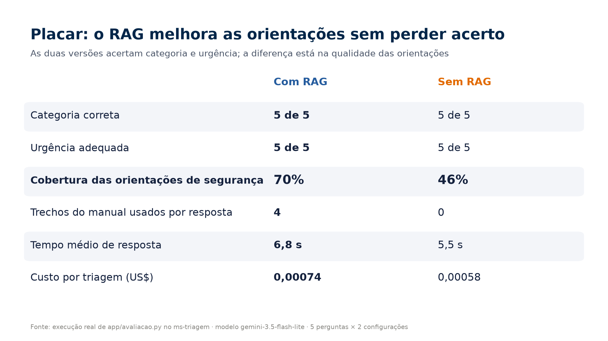
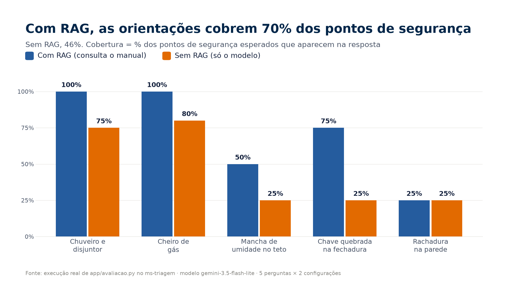
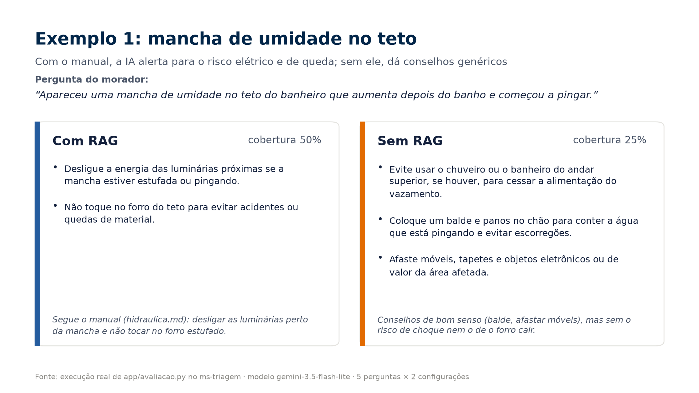
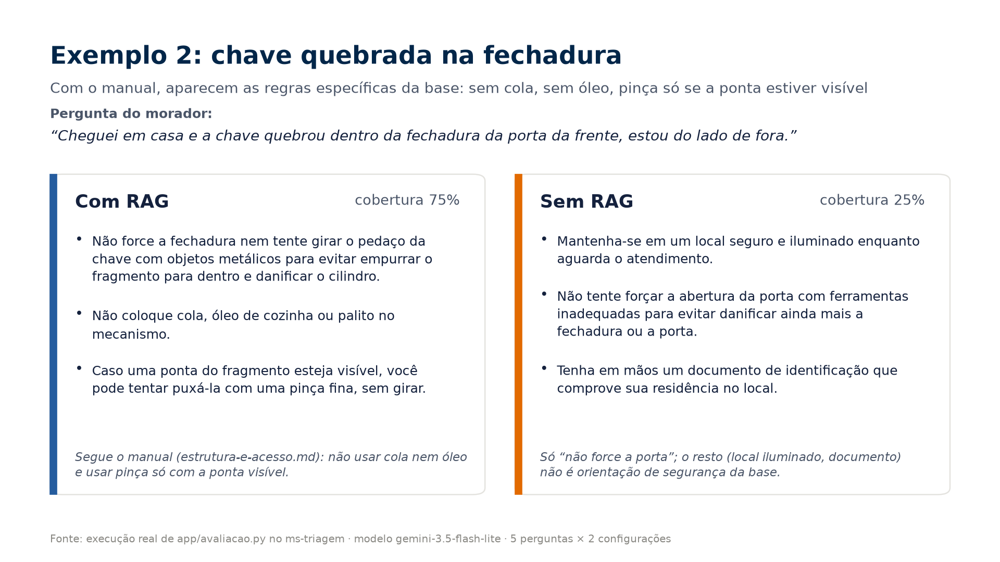
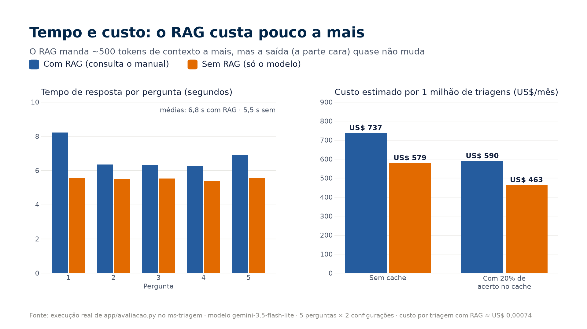

# Avaliação da qualidade do RAG (Parte 4, item 6.2)

Avaliação do assistente de triagem com **5 perguntas de teste**, cada uma respondida **com** e **sem** recuperação (RAG), com análise das respostas, do tempo e do custo.

- **Execução:** 26/11/2026. Foi uma rodada real contra o Gemini (`gemini-3.5-flash-lite`), com o script `services/ms-triagem/app/avaliacao.py` do `main` atual. Cache desligado e 10 respostas, todas vindas do modelo.
- **Arquivos desta pasta:** as imagens `01` a `06` (16:9, prontas para a apresentação), `relatorio-bruto.md` (saída do script) e `resultados.json` (respostas completas).

## Como medimos

| Medida | O que significa |
|---|---|
| **Categoria correta** | A IA escolheu o tipo de profissional esperado. |
| **Urgência adequada** | A urgência está entre as aceitáveis para o caso. |
| **Cobertura de segurança** | Cada pergunta tem de 4 a 5 "pontos de segurança" que o nosso manual manda dizer. A cobertura é a % desses pontos que aparecem nas orientações. Ela é medida por palavras-chave: avalia se a resposta segue a base, não se o texto está bonito. |
| **Tempo e custo** | O tempo da chain completa (RAG, LLM e tool) e o custo calculado pelos tokens reais × o preço do modelo. |

## Resultado geral

| Configuração | Categoria | Urgência | Cobertura média | Tempo médio | Custo/triagem |
|---|---|---|---|---|---|
| **Com RAG** | 5/5 | 5/5 | **70%** | 6,8 s | US$ 0,00074 |
| **Sem RAG** | 5/5 | 5/5 | **46%** | 5,5 s | US$ 0,00058 |

**Conclusão:** o modelo já sabe **classificar** sozinho, e as duas versões acertam tudo. O ganho do RAG está nas **orientações de segurança**: elas passam a seguir o nosso manual, com cobertura de 70% contra 46%.

## Análise pergunta a pergunta

| # | Pergunta | Com RAG | Sem RAG | Análise |
|---|---|---|---|---|
| 1 | Chuveiro não esquenta e o disjuntor desarma | 100%, urgência ALTA | 75%, urgência MÉDIA | Com o manual aparece a regra **"não troque o disjuntor por um de amperagem maior"**, que o modelo sozinho não deu. As duas urgências são aceitáveis. |
| 2 | Cheiro forte de gás na cozinha | 100%, EMERGÊNCIA | 80%, EMERGÊNCIA | O modelo já conhece o protocolo de gás. O RAG acrescenta "retire pessoas e animais" e a ordem certa: **Bombeiros (193) primeiro**. É o caso em que o RAG menos acrescenta. |
| 3 | Mancha de umidade no teto, pingando | 50% | 25% | Com o manual: **desligar as luminárias perto da mancha** e **não tocar no forro** (risco de choque e de queda). Sem ele, só conselhos genéricos: balde e afastar móveis. |
| 4 | Chave quebrada na fechadura | 75% | 25% | Com o manual vêm as regras da base: **sem cola, sem óleo, pinça só se a ponta estiver visível**. Sem ele, metade das orientações nem é de segurança ("tenha um documento em mãos"). |
| 5 | Rachadura diagonal grande que está aumentando | 25%, EMERGÊNCIA | 25%, ALTA | Empate na métrica. Com o manual, a IA trata como **risco de desabamento**: manda sair do imóvel e chamar a **Defesa Civil (199)**, como diz `urgencia.md` para rachaduras que crescem. Sem ele, sugere marcar a rachadura a lápis e esperar. A métrica por palavra-chave não captou essa diferença de gravidade. |

### O que a recuperação trouxe
O **trecho mais relevante veio certo nas 5 perguntas**: chuveiro → `seguranca-eletrica.md`, gás → `seguranca-gas.md`, mancha → `hidraulica.md`, chave e rachadura → `estrutura-e-acesso.md`. Entre os 4 trechos enviados há algum "ruído". Na pergunta da chave, por exemplo, veio também o teste do hidrômetro. O modelo ignorou esse trecho sem prejuízo. Uma melhoria possível é descartar trechos com distância alta, em vez de mandar sempre 4.

## Tempo e custo

- **Custo:** cerca de **US$ 0,00074 por triagem com RAG**, com ~833 tokens de entrada e ~195 de saída. O RAG soma ~500 tokens de contexto, o que encarece só ~27%, porque a saída é a parte cara e quase não muda. Em escala, isso dá **~US$ 737/mês para 1 milhão de triagens** (~US$ 590 com 20% de acerto no cache).
- **Tempo:** média de 6,8 s com RAG e 5,5 s sem. A parte local (busca no ChromaDB e tool) custa centenas de milissegundos; o gargalo é o modelo.
- **Ponto de atenção:** nesta rodada, as 10 respostas passaram do orçamento de produção de 5 s. Na avaliação os limites são afrouxados para medir a qualidade. **Em produção, uma resposta tão lenta cairia no fallback por regras**: o morador ainda recebe uma orientação, só que sem o modelo. A latência do provedor varia de um dia para outro; em outra medição, ficou entre 2,5 s e 6,3 s.

## Limitações
- São só 5 perguntas, e cada execução do modelo varia um pouco.
- A cobertura por palavra-chave mede aderência à base, mas não mede gravidade nem clareza (veja a pergunta 5).
- Nesta rodada isolada o `ms-prestadores` não estava ligado, então a tool não sugeriu profissionais. Isso não afeta as métricas acima, que olham só categoria, urgência e orientações.
